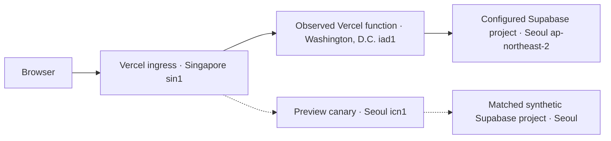
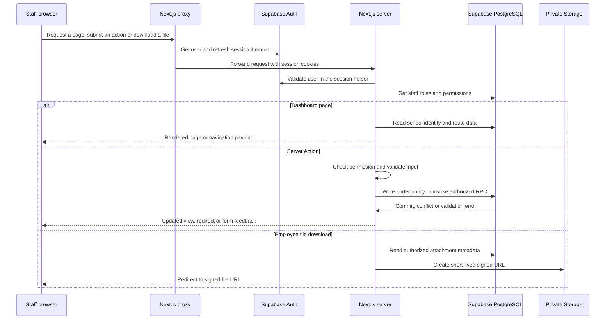
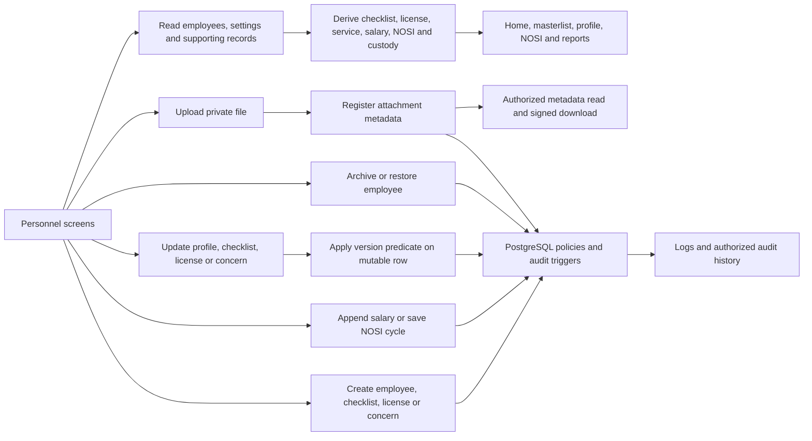
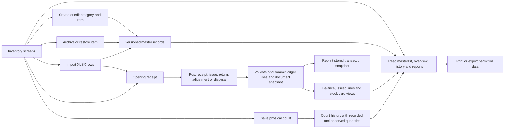
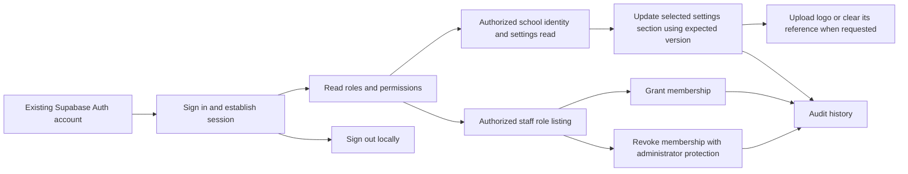
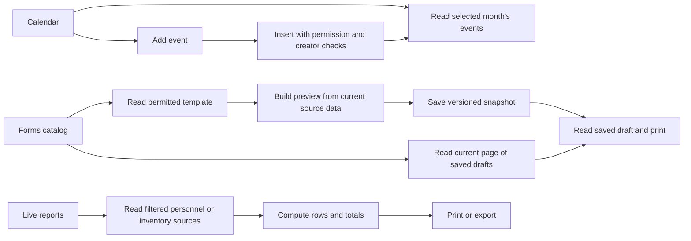
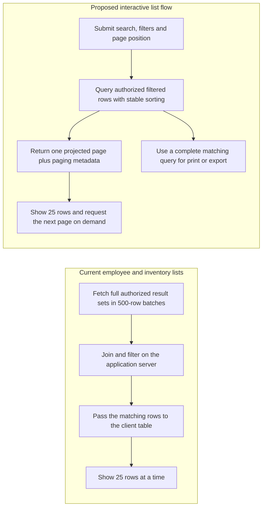

# School Admin Desk data fetching and CRUD report

Source reviewed at commit `9d2bef9`. The hosted repeat median time to a visible heading was 1.86–3.38 seconds, including Calendar and School settings. Start by tracing the hosted request across authentication, settings, route reads and rendering. Full-result fetching is a separate scaling concern for lists and reports.

## Hosted latency triage

### Verify request placement and timing

The live sign-in page and an authenticated Home request both returned an `x-vercel-id` with `sin1` ingress and `iad1` function execution. Supabase project metadata places the database in `ap-northeast-2`, Seoul. That places the observed Vercel function in Washington, D.C. and its configured Supabase project in Seoul. Request headers establish placement. Individual proxy, Auth and data hop durations still need tracing. The Seoul Vercel function region is `icn1`. Test a Seoul-region preview canary with matching synthetic data and roles, then compare individual hop durations and usable content timings before considering a production region change. This placement evidence establishes a mismatch. The savings are unmeasured. [How to read Vercel request IDs](https://vercel.com/blog/life-of-a-vercel-request-navigating-the-edge-network) · [Vercel regions](https://vercel.com/docs/regions) · [Function region configuration](https://vercel.com/docs/functions/configuring-functions/region)

Record where the proxy executes, where the Next.js render function executes, and where the Supabase project runs. Confirm those locations from deployment and project metadata. Compare each hop in traces before changing placement. Measure proxy Auth, render Auth, role RPC, settings and route reads separately, including HTTP duration, rows and bytes. Record shell response, visible heading and when the main content can be used. A single TTFB cannot identify which server hop is slow.



The solid path combines headers and project metadata. Dashed links describe the proposed comparison.

### Measure the authentication and layout path first

On matched requests the proxy awaits its own `getUser()` before forwarding. In the render, the React-cached session helper awaits a second `getUser()` and then `get_staff_access`. Layout and page calls can share that session result within the render. Settings and domain reads can proceed concurrently after the session resolves, and some pages explicitly start them together. The inventory landing currently awaits the entire master phase before starting issued lines, counts and recent activity for selected views. Those reads are chosen from the view parameter. [Proxy](../src/proxy.ts) · [Session helper](../src/modules/auth/session.ts) · [Dashboard layout](<../src/app/(dashboard)/layout.tsx>) · [Inventory workspace](<../src/app/(dashboard)/inventory/page.tsx>)

If proxy Auth is significant, test `getClaims()` in the proxy on a preview deployment. The hosted Supabase public JWKS lists ES256, and the review session token used the same asymmetric algorithm. With asymmetric signing and cached JWKS, verification can run locally. A cold key lookup, refresh or key change can require a network call. Symmetric signing requires a call to Auth. Keep the server's authoritative session check and live role lookup until expired tokens, refresh, sign-out, disabled users and role revocation pass regression checks. Signed claims alone do not establish fresh account or school role state. Evaluate roles embedded in access tokens only with a proven revocation design and checks that revoked users lose access to private records, files and write actions within the required window. [Supabase getClaims reference](https://supabase.com/docs/reference/javascript/auth-getclaims) · [Supabase SSR Auth](https://supabase.com/docs/guides/auth/server-side/creating-a-client)

If settings blocks the authenticated shell, test streaming the school identity under a boundary with a stable placeholder. Retain permission checks before protected content is rendered. Evaluate cross-request caching only for a minimal singleton identity projection after demonstrating identical visibility for every authorized role. Keep authorization outside the shared cache, invalidate the identity tag on committed edits, and verify freshness and access after role revocation. Keep private logos and signed URLs out of shared caching. If shared caching is justified, use `updateTag` after a successful settings Server Action when staff need to see that edit immediately. `revalidateTag` with the `max` profile allows stale data during background refresh. [Next.js updateTag](https://nextjs.org/docs/app/api-reference/functions/updateTag) · [Next.js revalidateTag](https://nextjs.org/docs/app/api-reference/functions/revalidateTag) [Dashboard layout](<../src/app/(dashboard)/layout.tsx>) · [Settings queries](../src/modules/settings/queries.ts) · [Settings actions](../src/modules/settings/actions.ts)


## Browser baseline

Playwright drove Chrome on the same workstation with an authenticated session. The local application ran a production build with `npm.cmd run start` against local Docker Supabase. Each pass made hard document loads across the routes. The first heading column shows the first observed pass. The two median columns use the three repeat passes. First response start uses the browser's document navigation timing `responseStart`, which can capture an interim response. Heading time is the browser clock from navigation start to the first visible heading under `#main-content`. It is a screen visibility milestone. Table readiness, layout stability and full interactivity require separate measurements.

| Local route | First heading (ms) | Repeat median first response start (ms) | Repeat median heading (ms) |
| --- | ---: | ---: | ---: |
| Home | 547 | 143 | 618 |
| Employees | 616 | 222 | 426 |
| Inventory overview | 711 | 151 | 332 |
| Inventory items | 477 | 239 | 488 |
| NOSI | 830 | 242 | 718 |
| Reports, default 201 completeness | 744 | 234 | 506 |
| Logs, audit view | 1,155 | 157 | 1,126 |
| Calendar | 229 | 64 | 237 |
| Forms | 358 | 139 | 326 |
| School settings | 654 | 181 | 356 |

All local navigations succeeded. The requested Reports URL was `/reports?report=201`, which resolves to the default 201 completeness report for a staff member with personnel read access. [Reports page](<../src/app/(dashboard)/reports/page.tsx>)

The audit Logs view had the slowest local repeat heading at 1,126 ms despite a 157 ms repeat median first response start. These are medians of different measurements. Their gap illustrates how early the response can start relative to the visible route milestone. The timing alone cannot assign the delay to a particular server query or browser stage.

### Hosted application

The hosted run used an authenticated review role and the same workstation and measurement procedure. The 40 hosted and 40 local hard loads all succeeded. The local and hosted test accounts and available records can differ, including local records added during testing. These runs describe the two observed environments. They do not isolate deployment, permission or data-volume effects.

| Hosted route | First heading (ms) | Repeat median first response start (ms) | Repeat median heading (ms) | Repeat heading range (ms) |
| --- | ---: | ---: | ---: | ---: |
| Home | 2,956 | 48 | 3,384 | 2,708–3,403 |
| Employees | 3,887 | 49 | 3,192 | 2,388–3,652 |
| Inventory overview | 3,397 | 46 | 2,479 | 2,347–3,360 |
| Inventory items | 1,941 | 47 | 2,451 | 1,984–2,584 |
| NOSI | 2,727 | 49 | 2,887 | 2,155–3,832 |
| Reports, default 201 completeness | 2,967 | 48 | 2,890 | 2,615–3,168 |
| Logs, audit view | 5,148 | 48 | 3,131 | 3,091–3,777 |
| Calendar | 2,362 | 47 | 2,048 | 1,618–2,791 |
| Forms | 3,358 | 50 | 2,814 | 2,025–3,045 |
| School settings | 2,780 | 47 | 1,862 | 1,355–2,619 |

The original hosted `responseStart` medians were 46–50 ms. A follow-up authenticated Home load returned `responseStart` and `firstInterimResponseStart` at 47.3 ms, final response headers at 3,276.4 ms, and the Home records section at 4,435.6 ms. In that load the early timestamp represented an interim response. A separate authenticated Employees load recorded the Chrome DevTools Protocol Early Hints event for its main document, confirming a 103 before HTTP 200 on that request. The original run lacked the fields needed to classify every sample. Treat those early medians as first response start. Compare final response headers and usable content in follow-up runs. Stage-level traces are still needed for database region effects and per-query timing. [Navigation Timing final response headers](https://developer.mozilla.org/en-US/docs/Web/API/PerformanceResourceTiming/finalResponseHeadersStart) · [Chrome Early Hints event](https://chromedevtools.github.io/devtools-protocol/tot/Network/#event-responseReceivedEarlyHints)

```text
Median time to visible heading     Local ░      Hosted █     1 block ≈ 200 ms

Home                ░░░            618 ms   █████████████████  3,384 ms
Employees           ░░             426 ms   ████████████████   3,192 ms
Inventory overview  ░░             332 ms   ████████████       2,479 ms
Inventory items     ░░             488 ms   ████████████       2,451 ms
NOSI                ░░░░           718 ms   ██████████████     2,887 ms
201 report          ░░░            506 ms   ██████████████     2,890 ms
Logs, audit view    ░░░░░░       1,126 ms   ████████████████   3,131 ms
Calendar            ░              237 ms   ██████████         2,048 ms
Forms               ░░             326 ms   ██████████████     2,814 ms
School settings     ░░             356 ms   █████████          1,862 ms
```

### Hosted follow-up with usable content

Chrome 158 made 10 read-only hard loads per route using the same review account in a fresh authenticated context, with sequential rounds and no network throttling. The readiness markers check that route content is visible. A separate interaction probe is needed to verify hydration and whether controls respond. In this run, p95 uses nearest rank and is the slowest of 10 observations. These are descriptive samples from this browser and account.

| Route | Median first response start (ms) | Median final response headers (ms) | Usable-content marker | Median marker (ms) | p95 marker (ms) |
| --- | ---: | ---: | --- | ---: | ---: |
| Home | 49 | 2,049 | Records section visible | 3,254 | 4,436 |
| Employees | 49 | 2,079 | First employee link in the table visible | 3,249 | 4,240 |
| Inventory items | 48 | 1,627 | First item detail link in the table visible | 2,341 | 3,107 |
| Logs, audit view | 47 | 1,635 | First audit row visible | 3,583 | 5,165 |

All 40 read-only loads succeeded, reported interim navigation timing, and returned the `sin1::iad1` region chain.

```text
Hosted follow-up medians      Final headers ░     Visible content █    1 block ≈ 250 ms

Home                          ░░░░░░░░             2,049 ms   █████████████   3,254 ms
Employees                     ░░░░░░░░             2,079 ms   █████████████   3,249 ms
Inventory items               ░░░░░░░              1,627 ms   █████████       2,341 ms
Logs, audit view              ░░░░░░░              1,635 ms   ██████████████  3,583 ms
```

### Local SQL samples

One read-only `EXPLAIN (ANALYZE, BUFFERS, FORMAT JSON)` per query used the local seeded database under the authenticated demo administrator identity. These results measure executor time in a single run. API, network, end-to-end serialization and browser rendering need separate instrumentation.

| Query shape | Result rows | Executor (ms) |
| --- | ---: | ---: |
| Audit rows in newest-first order with all columns | 1,593 | 4.766 |
| Audit list projection limited to 25 | 25 | 4.176 |
| All employees in name and ID order | 41 | 2.956 |
| Active employee list projection limited to 25 | 25 | 3.697 |
| All inventory balance rows | 63 | 6.692 |

The audit plans estimated 706 bytes per row for the full row and 90 for the list projection. The actual Logs helper already uses the projection. A database limit would bound the number of projected rows sent for the initial page. These samples illustrate the difference in result shape. Production query time and response-byte savings need direct measurements. [Audit read](../src/modules/personnel/queries.ts)

## How a request reaches the data



The proxy validates the user on matched requests and writes refreshed cookies to the response when needed. The server session helper separately validates the user and then calls `get_staff_access`. React `cache` shares session, settings and selected query results during a server render. The proxy is a separate execution boundary, and a later server render can run these calls again. The dashboard layout awaits the session and school settings before rendering the school identity and permission-aware navigation. Route Handlers have their own authorization entry points. [Proxy](../src/proxy.ts) · [Server client](../src/lib/supabase/server.ts) · [Session helper](../src/modules/auth/session.ts) · [Dashboard layout](<../src/app/(dashboard)/layout.tsx>) · [Settings queries](../src/modules/settings/queries.ts)

Supabase receives the staff member's authenticated identity. Permission checks in Next.js govern actions and views, while PostgreSQL row-level security controls direct table access and explicitly authorized functions enforce their own write rules. Audit triggers record significant changes. Version checks are specific to each mutable workflow and include timestamps on employee profiles, checklist review, settings and inventory master records. [Foundation migration](../supabase/migrations/20261121000100_foundation.sql) · [Personnel migration](../supabase/migrations/20261121000200_personnel.sql) · [Inventory migration](../supabase/migrations/20261121000300_inventory.sql)

## CRUD operations by record

A dash indicates there is no staff-facing action for that operation. Archive, deactivation, role revocation and disposal are shown explicitly because they lead to different stored results. See the [prototype workflow coverage](workflow-coverage.md) for the screens and printable templates.

| Record or workflow | Create | Read | Update | Delete or retention | Source |
| --- | --- | --- | --- | --- | --- |
| Staff Auth account and session | Account provisioned in Supabase Auth | Sign in, validate session and check permissions | Refresh session cookies | Sign out locally and retain account | [Auth actions](../src/modules/auth/actions.ts) |
| Staff role membership | Grant a role to an existing Auth account | List staff roles and resolve the current user's access | Change effective access through grants and revocations | Revoke a membership by deleting its row with last-administrator protection | [Settings actions](../src/modules/settings/actions.ts) · [Foundation migration](../supabase/migrations/20261121000100_foundation.sql) |
| School settings and logo | Singleton seeded by migration. Staff can upload a private logo object | Read identity, signatories and rules. Sign logo URLs when needed | Save one settings section against its submitted version. Update or clear the logo reference | Retain settings and existing logo objects | [Settings actions](../src/modules/settings/actions.ts) · [Settings queries](../src/modules/settings/queries.ts) |
| Employees | Create employee with optional opening salary and license using a database function | Home, masterlist, profile and report projections | Edit active record with timestamp check. Archive or restore sets or clears the archive timestamp | Archive keeps employee and dependent history | [Personnel actions](../src/modules/personnel/actions.ts) · [Personnel queries](../src/modules/personnel/queries.ts) |
| 201 document types and checklist | Types seeded. Save a first checklist status row | Read active types, values and review metadata | Change status with version check. Save review date and remarks against employee version | Retain rows. N/A is an explicit status | [Document actions](../src/modules/personnel/document-actions.ts) · [Personnel migration](../supabase/migrations/20261121000200_personnel.sql) |
| Employee attachments | Upload validated file to private storage, then register its metadata | Read authorized metadata and obtain a signed download link | — | Action attempts cleanup if registration fails. Registered attachments have no staff delete action | [Document actions](../src/modules/personnel/document-actions.ts) · [Download handler](<../src/app/api/employee-documents/[id]/route.ts>) |
| Employee licenses | Add license entry or include initial expiry during creation | Read license history and derive relevant expiry | Update an entry or deactivate it | Inactive entries remain in history | [Personnel actions](../src/modules/personnel/actions.ts) |
| Employee salary history | Append effective-dated entry or record opening salary | Read salary history and derive current salary and step from dates | — | Append-only | [Personnel actions](../src/modules/personnel/actions.ts) · [Personnel migration](../supabase/migrations/20261121000200_personnel.sql) |
| NOSI progress | Create a record for the current step cycle | Read cycle history, status and calculated eligibility | Change status for the validated current cycle with version check | Retain history of earlier cycles | [Personnel actions](../src/modules/personnel/actions.ts) |
| Concern logs | Add concern with details, category, priority and assignee | Read concerns in Logs | Change status and resolution date with version check | — | [Personnel actions](../src/modules/personnel/actions.ts) · [Personnel queries](../src/modules/personnel/queries.ts) |
| Audit logs | Database triggers append entries | Read with audit permission through Logs | — | — | [Foundation migration](../supabase/migrations/20261121000100_foundation.sql) · [Personnel queries](../src/modules/personnel/queries.ts) |
| Inventory categories | Create category | Read for item filters, forms and reports | Edit with expected timestamp | — | [Inventory actions](../src/modules/inventory/actions.ts) · [Inventory migration](../supabase/migrations/20261121000300_inventory.sql) |
| Inventory items | Add individually or from XLSX. Opening stock posts as receipts | Read masterlist, details, balances and reports | Versioned edits, archive or restore | Archive retains ledger and references | [Inventory actions](../src/modules/inventory/actions.ts) · [Inventory queries](../src/modules/inventory/queries.ts) |
| Inventory transactions and saved transaction documents | Post receipts, issues, returns, adjustments and disposal. Store ledger lines plus the transaction snapshot | Read balances, activity, stock card, issued or returned stock, custody and saved documents | Record new transactions to represent later movements | Disposal is a ledger entry that reduces stock. Posted entries are retained | [Inventory actions](../src/modules/inventory/actions.ts) · [Inventory migration](../supabase/migrations/20261121000300_inventory.sql) |
| Physical counts | Save observed quantity separately from recorded balance, cost and count date | Read count history, latest count and variance reports | Record a new count | — | [Inventory queries](../src/modules/inventory/queries.ts) · [Inventory migration](../supabase/migrations/20261121000300_inventory.sql) |
| Calendar events | Add a shared one-day event with optional time and notes | Read selected month's events | — | — | [Calendar actions](../src/modules/calendar/actions.ts) · [Calendar migration](../supabase/migrations/20261121000500_calendar.sql) |
| Form templates and saved drafts | Templates installed through migrations. Preview builds transient data. Save inserts a versioned snapshot | Browse authorized templates and saved drafts. Reopen and print a stored snapshot | Generate a new draft for changed data | — | [Draft actions](../src/modules/documents/actions.ts) · [Draft queries](../src/modules/documents/queries.ts) · [Documents migration](../supabase/migrations/20261121000400_documents.sql) |
| Derived reports and export files | Generate print output or downloads on demand | Read source records with applicable personnel or inventory permissions | Change filter parameters and regenerate | No saved report record in these flows | [Personnel report handler](../src/app/api/reports/personnel/route.ts) · [Inventory export handler](../src/app/api/inventory/export/route.ts) · [Inventory reports](<../src/app/(dashboard)/inventory/reports/[report]/page.tsx>) |

### Personnel, 201 files and logs



### Property and inventory



### Authentication, settings and staff access



### Calendar, forms and reports



## Where fetching and rendering cost can grow

### The 25 visible rows are a rendering window

The table component receives all row elements provided by its caller. It derives page count from those children and slices 25 into the visible body. Clicking its arrows changes local state and issues no database request. With `printAll`, additional rows also render in print-only table bodies. Upstream personnel and inventory helpers separately loop through Supabase ranges of 500 until a page returns fewer than 500 rows, so the number shown on screen says little about how many rows crossed the database connection. Saved drafts are bounded at the database to 21 rows per request, displaying 20 with a look-ahead row. Recent inventory activity also has a real database limit of 25. [Shared table](../src/components/ui/table.tsx) · [Personnel queries](../src/modules/personnel/queries.ts) · [Inventory queries](../src/modules/inventory/queries.ts) · [Saved draft queries](../src/modules/documents/queries.ts)

### Auth and school identity are shared startup work

A matched fresh dashboard request can pay for the proxy's Auth call and then the server session's Auth and staff-access calls before protected reads proceed. The layout's settings read also sits behind successful session resolution. Within the same render the cached access and settings helpers can share results. Cold direct loads and warm in-app navigations should be measured separately to account for the router, layouts, prefetching and connection reuse. [Proxy](../src/proxy.ts) · [Session helper](../src/modules/auth/session.ts) · [Dashboard layout](<../src/app/(dashboard)/layout.tsx>) · [Settings queries](../src/modules/settings/queries.ts)

### Personnel loads data for broader use than each screen needs

The overview starts settings context, six paged reads for employees, document types, checklist statuses, licenses, salaries and NOSI records, and a paged custody totals RPC. It groups by employee and derives summaries in JavaScript. The masterlist applies search and its selected filter after assembly and evaluates the personnel filters again for each option's count. Parallel reads reduce the number of sequential waits across sources, but each source still reads its 500-row chunks sequentially. Profile reads scope the supporting rows by employee ID, then fetch permitted attachments and custody in a second phase. Logs fetch salary history separately even though the overview also fetches it. An employee picker in Forms can use the same full overview for labels and IDs. [Personnel queries](../src/modules/personnel/queries.ts) · [Masterlist](<../src/app/(dashboard)/employees/page.tsx>) · [Forms](<../src/app/(dashboard)/forms/page.tsx>)

### Inventory blends full master data and view-specific work

The master helper reads all categories, items and the derived balances view, then joins rows in JavaScript. Inventory filters operate after the full master result. The main route waits for the master phase before starting its conditional reads for recent documents, issued lines and counts, although the view parameter alone determines which reads it starts. Category management and new-item forms call the same master helper for categories. Detail and stock-card reads can also depend on it for a single item. The export handler reads the full inventory before it validates output format or returns the empty import template. Recent activity also limits the latest 25 documents globally before category and item filtering, so a filtered view can omit older matching entries. The transaction form loads all eligible items and can send employee or return options to the client. Its directory RPC has no paging loop, so it can encounter the configured API row limit. Aggregation over the ledger is another potential cost to measure at realistic volumes. [Inventory queries](../src/modules/inventory/queries.ts) · [Inventory workspace](<../src/app/(dashboard)/inventory/page.tsx>) · [Inventory categories](<../src/app/(dashboard)/inventory/categories/page.tsx>) · [New item page](<../src/app/(dashboard)/inventory/items/new/page.tsx>) · [Transaction form route](<../src/app/(dashboard)/inventory/transactions/[kind]/page.tsx>) · [Supabase config](../supabase/config.toml) · [Inventory export](../src/app/api/inventory/export/route.ts) · [Inventory views](../supabase/migrations/20261121000300_inventory.sql)

### Some saves reread broad data

Saving NOSI first loads the full employee profile, including checklist and other profile data, to validate one current cycle and saved version. Previewing or saving an employee-specific draft uses the same profile loader. Personnel and file actions can invalidate the root layout, while inventory actions invalidate the inventory layout and Home. Measure post-submit time through the mutation and subsequent navigation or refresh. Narrowing an input projection still needs to preserve cycle eligibility, the submitted version and the exact fields used in snapshots. [Personnel actions](../src/modules/personnel/actions.ts) · [Personnel file actions](../src/modules/personnel/document-actions.ts) · [Draft actions](../src/modules/documents/actions.ts) · [Inventory actions](../src/modules/inventory/actions.ts)

### Reports intentionally consume more rows

Personnel reports use the full personnel overview and shared eligibility rules before producing filtered rows. Inventory reports load the master before choosing a report. Date-filtered inventory document reads already filter by kind and date in PostgreSQL, then JavaScript parses snapshots, filters lines to selected items and aggregates totals. The issued report applies its date filter in the application, and as-of count reports collect historical counts through the date and reduce them to one row per item in memory. Printing requires the full matching result, so interactive paging should preserve a separate complete print or export path. [Personnel reports](../src/modules/reports/personnel.ts) · [Inventory report routes](<../src/app/(dashboard)/inventory/reports/[report]/page.tsx>) · [Inventory report data](../src/modules/inventory/report-data.ts) · [Inventory queries](../src/modules/inventory/queries.ts)

### Calendar already scopes the read by month

Calendar selects five columns within the requested date range and the migration defines a month-oriented index. A month still loops through ranges of 500 if necessary. Calendar navigation that changes the URL through `router.push` may incur a server render and authentication overhead even when the selected day's events are already available in the loaded month. Measure same-month day selection separately from crossing to a month that depends on new data. [Calendar query](../src/modules/calendar/queries.ts) · [Calendar migration](../supabase/migrations/20261121000500_calendar.sql) · [Month calendar](../src/components/month-calendar.tsx)

## How database paging would change the list flow



## Follow-up work in priority order

| Priority | Work | Acceptance criteria |
| --- | --- | --- |
| 0. Trace hosted latency | Run at least 10 passes per route, condition and environment. Separate direct loads, warm in-app links and filters. Match roles, deployment build and synthetic dataset sizes on local and preview, with a small seed and a larger fixture such as 2,000 employees and 20,000 inventory ledger lines on both environments. Use read-only navigation for production and run write measurements on local or preview only. | Publish sample count, median and p95 for heading and usable content. Treat p95 from a small sample as descriptive and increase repetitions when estimates vary. Mark usable content with concrete route checks such as employee results and an enabled filter, Calendar grid with events, or actual report rows. Capture Navigation Timing, response/RSC bytes, server spans and query row counts. Redact tokens, signed URLs and record values. |
| 1. Test latency changes in preview | Compare a Seoul function canary, then isolate a proxy getClaims() change. Parallelize independent inventory view reads. Test streaming school identity if traces identify it as a shell blocker. | Compare final headers, visible content and usable interactions. Confirm session refresh, current role lookup and revocation still behave as intended. |
| 2. Correct inventory query scope | Apply category and item filters before limiting recent activity to 25. Keep stable newest-first ordering with an ID tie-breaker, and avoid duplicate documents when several lines match. Page the eligible employee directory past the API cap. Check permission and validate export format before inventory reads. Return the blank import workbook immediately after authorization. Give category-only screens a narrow read. Use a minimal authorized employee projection for the Forms picker. | Verify that scoped activity can show an older match outside the global top 25. Check the directory across a page boundary for missing or duplicated employees. Confirm unauthorized exports fail, invalid formats return a controlled error, and a blank template reads no master rows. Preserve existing user-facing filter semantics and RLS. |
| 3. Scale lists and reports | Apply filters and narrow projections in PostgreSQL before returning one interactive page. Use stable offset paging when numbered navigation is required and drift is acceptable. For frequently changing histories, evaluate keyset paging with a unique tie-breaker in the cursor. Compute facets and rows with the same active status, eligibility and reference-date rules. Keep complete authorized print and export queries. Consider scoped as-of count and issued-line report reads where traces show material cost. | Bound initial rows as data grows. Test equal sort keys and concurrent inserts, consistent employee filter counts and report membership, and complete print/export results. Compare plans and rows under the same RLS context before adding indexes or derived summaries. |
| 4. Narrow writes and refresh | Measure action submission through visibly updated data. Fetch only fields needed for decisions such as NOSI eligibility and version. Keep stale-write checks atomic at the mutation with the expected version predicate or transactional database function. Preserve ledger posting, count snapshots and audit behavior. Limit revalidation after testing each affected view. | Simultaneous edits yield the expected success/conflict outcomes. Retried or rejected writes preserve inventory integrity. Home, profile, lists, logs and reports show committed changes when applicable. |
| 5. Tune Calendar navigation | Consider selecting days locally within the loaded month. Keep canonical URL state in sync and fetch server data when the month changes or revalidates. | Deep links and browser back/forward reproduce the correct date and selection. Adding an event refreshes the relevant agenda. Compare day changes and month changes independently. |


For each optimization, compare multiple roles and verify PostgreSQL permissions and storage policies through the normal entry points. Use `security_invoker = true` for caller-scoped views and explicit authorization in RPCs, particularly security-definer functions. If evaluating an RLS policy change such as `(select auth.uid())`, use the subquery only for statement-invariant identity and confirm equivalent results and plans under the relevant roles. Preserve attachment authorization before signing and the scope needed to open saved drafts. Preserve expected versions on edits, append-only salary and ledger histories, last-administrator protection, audit triggers, and draft or transaction snapshots. Confirm failed or stale writes leave the intended state. [Foundation migration](../supabase/migrations/20261121000100_foundation.sql) · [Personnel migration](../supabase/migrations/20261121000200_personnel.sql) · [Inventory migration](../supabase/migrations/20261121000300_inventory.sql) · [Documents migration](../supabase/migrations/20261121000400_documents.sql)
